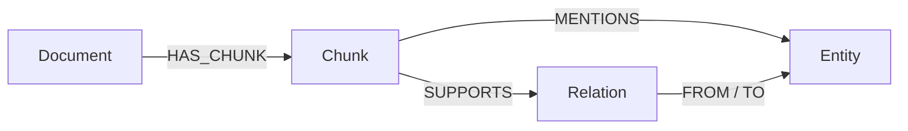

# Stage 4 — Evidence-linked knowledge graph

## What is added

Stage 3 answers “which passages are relevant?” Stage 4 adds a graph that answers “which named
things are connected, and which exact source passage supports that connection?”

For every latest, authorized parent chunk, the extraction model returns a small structured object:

- entities: people, initiatives, systems, risks, dates or other explicitly named concepts;
- relations: a source entity, a relation type, a target entity and a copied evidence sentence.

The service rejects relation endpoints that are not present in the extracted entity list and drops
any relation whose evidence text cannot be found in the source chunk. That means the graph is not
just a set of model guesses: every stored relationship points back to a concrete chunk.

## Data model



A relation is a node rather than a direct edge because it carries evidence, document identity and
version provenance. This makes audits and citations possible.

## Pipeline

1. `POST /v1/documents` stores a versioned document and child embeddings in PostgreSQL.
2. `POST /v1/graph/enrich` loads only the latest ready parent chunks that the caller may access.
3. `gpt-4.1-mini` is asked for schema-constrained entities and relations at temperature zero.
4. The application validates relation endpoints, removes duplicate output and verifies quoted
   relation evidence against the original chunk.
5. Neo4j merges tenant-scoped entities, then links mentions and evidence-bearing relations to the
   supporting chunk and document.
6. `POST /v1/graph/search` uses Neo4j full-text entity search. It re-applies tenant, scope,
   private-owner and latest-version filters inside Cypher before returning results.

## Why this complements vector search

| Retrieval style | Best at | Example |
| --- | --- | --- |
| Vector + keyword hybrid search | Finding relevant source passages | “Why was Atlas delayed?” |
| Graph search | Finding named entities and relationships | “Who owns payment reliability?” |

Later, the query router will combine both evidence sets, rerank them and only then let a model
compose a cited answer.

## Manual verification

Use an existing document ID from the successful `POST /v1/documents` response. Replace only the
placeholder value below.

```bash
curl -s -X POST http://localhost:8000/v1/graph/enrich \
  -H "Content-Type: application/json" \
  -d '{
    "document_id": "PASTE_DOCUMENT_ID_HERE",
    "tenant_id": "acme",
    "user_id": "u1",
    "allowed_scopes": ["team"]
  }' | python3 -m json.tool
```

Expected result: `processed_chunks` is 4 for the included sample document. The exact count of
entities and relationships can vary slightly because it is model output, but each relationship
must have copied evidence.

Then search the graph:

```bash
curl -s -X POST http://localhost:8000/v1/graph/search \
  -H "Content-Type: application/json" \
  -d '{
    "query": "Priya Shah",
    "tenant_id": "acme",
    "user_id": "u1",
    "allowed_scopes": ["team"],
    "limit": 10
  }' | python3 -m json.tool
```

## Failure modes and production improvements

- **Extraction cost and latency:** this development endpoint runs synchronously. Production should
  enqueue enrichment in Redis/Celery or a workflow service and expose job status.
- **Entity inconsistency:** “Priya”, “Priya Shah” and misspellings can become separate entities.
  Add entity resolution, aliases and human review for high-impact domains.
- **Over-extraction:** low-value entities add noise. Maintain an allowed entity taxonomy and
  monitor entity/relation counts per document.
- **Graph staleness:** changing a document produces a newer PostgreSQL version. Searches filter
  Neo4j chunks against each document's latest version so old graph facts are not returned; a
  production job should also retire old graph nodes to control storage.
- **Authorization:** user and scope values are API inputs only in this demo. A real deployment
  must derive them from verified identity claims and use database-level tenant controls.
- **Full-text candidate crowd-out:** graph search asks Neo4j for a wider candidate set before
  filtering by tenant, reducing the chance another tenant's popular terms hide authorized results.
