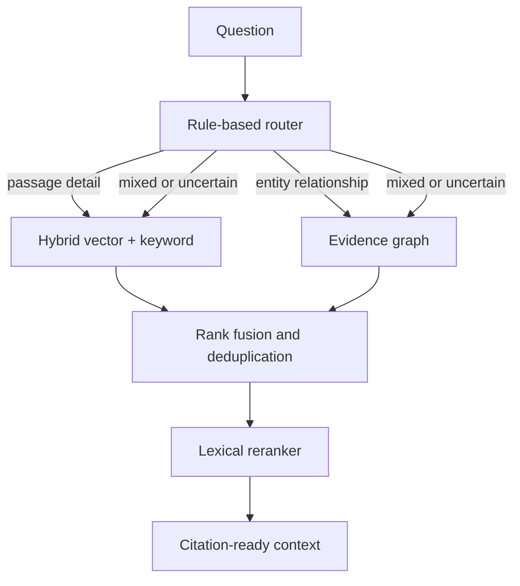

# Stage 5 — Query routing, evidence fusion and context assembly

## Purpose

This stage turns separate retrieval systems into one answer-ready evidence pipeline without
asking a language model to write an answer yet. Keeping this boundary explicit makes debugging,
evaluation and safety controls possible.

## Pipeline



1. The router identifies relationship signals such as “who”, “owner”, “depends” and “connected”,
   alongside document-detail signals such as “why”, “when”, “summary” and “decision”.
2. Relationship-only questions query Neo4j, with a hybrid-passage fallback if the graph has no
   authorized result. Detail-only questions query Stage 3 hybrid passage retrieval. Mixed or
   ambiguous questions query both for higher recall.
3. Each channel contributes a reciprocal-rank value based on position, not its raw database score.
   This is important because a pgvector similarity and a Neo4j full-text score have different
   meanings and cannot be safely added together.
4. Duplicate graph hits for the same source chunk and evidence sentence are merged. If a graph
   evidence sentence is already contained in a retrieved parent passage from the same source, the
   two channels are merged into one richer evidence block. All graph relationships supported by
   that passage are retained in its `graph_relations` field.
5. A transparent reranker blends normalized retrieval rank (70%) and query-token overlap (30%).
6. The context assembler assigns stable citations (`E1`, `E2`, ...), preserves source/chunk
   provenance and stops once it reaches the configured token budget.

## Endpoint

`POST /v1/retrieve` returns `route`, `route_reason`, ranked `evidence`, and `context`. It does
not generate text or claim an answer is correct.

```bash
curl -s -X POST http://localhost:8000/v1/retrieve \
  -H "Content-Type: application/json" \
  -d '{
    "query": "Who owns payment reliability and why was the Atlas launch delayed?",
    "tenant_id": "acme",
    "user_id": "u1",
    "allowed_scopes": ["team"],
    "limit": 8
  }' | python3 -m json.tool
```

For the Atlas sample, the route should be `hybrid`. The evidence should include both the ownership
relationship and the payment-testing delay passage, each with a citation and source provenance.

## Tunable controls

| Setting | Default | Why it matters |
| --- | ---: | --- |
| `ORCHESTRATION_CANDIDATE_LIMIT` | 12 | Controls recall and latency before the final evidence limit. |
| `CONTEXT_MAX_TOKENS` | 3000 | Caps cost and reduces irrelevant context for the future answer model. |
| `limit` request field | 8 | Caps how many reranked evidence blocks the caller receives. |

## Known limitations and next improvements

- The router is intentionally rule-based. It is predictable and easy to test, but a production
  system should evaluate it against labeled queries and may add a small classifier with a safe
  hybrid fallback.
- The current reranker is lexical and inexpensive. A later cross-encoder reranker can improve
  relevance, but must be measured against latency and cost.
- Graph hits return their copied evidence sentence, while passage hits return parent context. The
  next stage will use these source blocks to produce an answer with citations.
- Context is assembled synchronously. Production workloads can cache retrieval results in Redis
  and track route, latency and evidence quality in observability dashboards.
