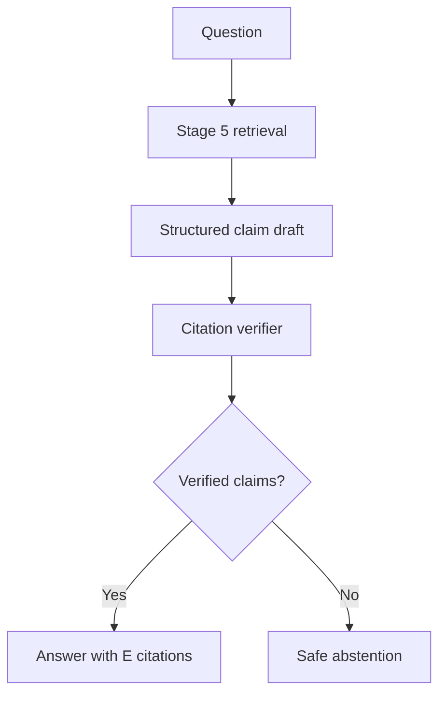

# Stage 6 — Grounded answers, verification and safe abstention

Stage 6 turns the citation-ready evidence assembled in Stage 5 into an answer **only after each
claim passes a separate verification check**. It does not treat the language model's first draft
as trusted output.

## What is new

- `POST /v1/answers` accepts the same tenant, user and allowed-scope inputs as retrieval.
- The drafting model returns structured, atomic claims plus evidence labels such as `E1`.
- Python rejects citation labels that were not returned by retrieval.
- A separate verification model checks every claim/citation pair against the exact evidence.
- The API composes its final answer from verified claims only; no uncited introduction or model
  prose is added.
- If there is no evidence, no verified claim, or the groundedness threshold is missed, it returns
  the fixed safe-abstention response.



## Why two model passes?

The draft model is optimized to answer the question. That is useful but risky: it can combine
facts too broadly, use an unsupported detail, or cite the wrong passage. The verifier has a
narrower job: decide whether each exact claim is explicitly supported by each citation. The
application then enforces the verifier's result in Python.

This is defense in depth, not a guarantee of truth. A model verifier can still make mistakes, so
production teams should sample answers for human review and track verification failures.

## Confidence fields

| Field | Meaning |
| --- | --- |
| `retrieval_quality` | Mean rerank score of evidence cited by accepted claims. |
| `groundedness` | Accepted claims divided by all drafted claims. |
| `citation_coverage` | Accepted claims with citations divided by all drafted claims. |
| `overall` | 35% retrieval quality + 45% groundedness + 20% citation coverage. |
| `label` | `high` at 0.80+, `medium` at 0.55–0.7999, otherwise `low`. |

`MIN_GROUNDEDNESS` defaults to `0.75`: when one of two drafted claims fails verification, the
system abstains rather than silently returning only the convenient half of the original answer.

## Live test

First make sure the Stage 3 document was ingested and Stage 4 graph enrichment completed. Then
run this from the project folder:

```bash
curl -s -X POST http://localhost:8000/v1/answers \
  -H 'Content-Type: application/json' \
  -d '{
    "query":"Who owns payment reliability and why was the Atlas launch delayed?",
    "tenant_id":"acme",
    "user_id":"sujal",
    "allowed_scopes":["team"],
    "limit":8
  }' | python3 -m json.tool
```

Expected characteristics:

- `decision` is `answered` only if every returned claim was supported.
- The answer contains citations, for example `[E1]` and `[E3]`.
- `citations` contains the source file, chunk ID, source text and rerank score for each used label.
- `claims` is an audit trail containing the verifier’s reasons.

To exercise safe abstention, ask for a fact not in the Atlas document, such as a marketing-budget
approval. The correct behavior is `decision: "abstained"`, not a guessed budget.

## Configuration

| Setting | Default | Purpose |
| --- | --- | --- |
| `GENERATION_MODEL` | `gpt-4.1-mini` | Structured claim drafting model. |
| `VERIFICATION_MODEL` | `gpt-4.1-mini` | Structured claim/citation verifier. |
| `ANSWER_MAX_CLAIMS` | `6` | Bounds answer length and verification cost. |
| `MIN_GROUNDEDNESS` | `0.75` | Minimum accepted/drafted claim ratio. |

The API key stays in `.env` and is passed to Docker through Compose. Clients never send a key to
`/v1/answers`.

## Common failure modes

| Symptom | Likely cause | Response |
| --- | --- | --- |
| HTTP 503 mentioning `OPENAI_API_KEY` | Key is missing from `.env` or not visible to the rebuilt container. | Add the key to `.env`, then rebuild. |
| HTTP 502 | OpenAI generation or verification request failed. | Check API logs, retry with backoff, and add rate-limit handling before production. |
| Frequent abstentions | Retrieval did not find evidence, chunks are poor, or threshold is too strict. | Inspect `/v1/retrieve` first; improve documents/chunks before lowering safety thresholds. |
| Incorrect but cited answer | A verifier made a bad judgement or source itself is wrong. | Add human evaluation cases, stronger verifier prompts/models, and source-quality controls. |
| High cost/latency | Two model calls happen after retrieval. | Cache by document version + query, use small models, and route simple factual queries selectively. |

## Production improvements still to build

Stage 7 should add a curated evaluation set, answer/citation metrics, tracing, rate limits,
authentication, tenant-isolation tests, redaction controls, retries, cache policy, and a React
review interface. These are important before treating this local demonstration as a production
service.
