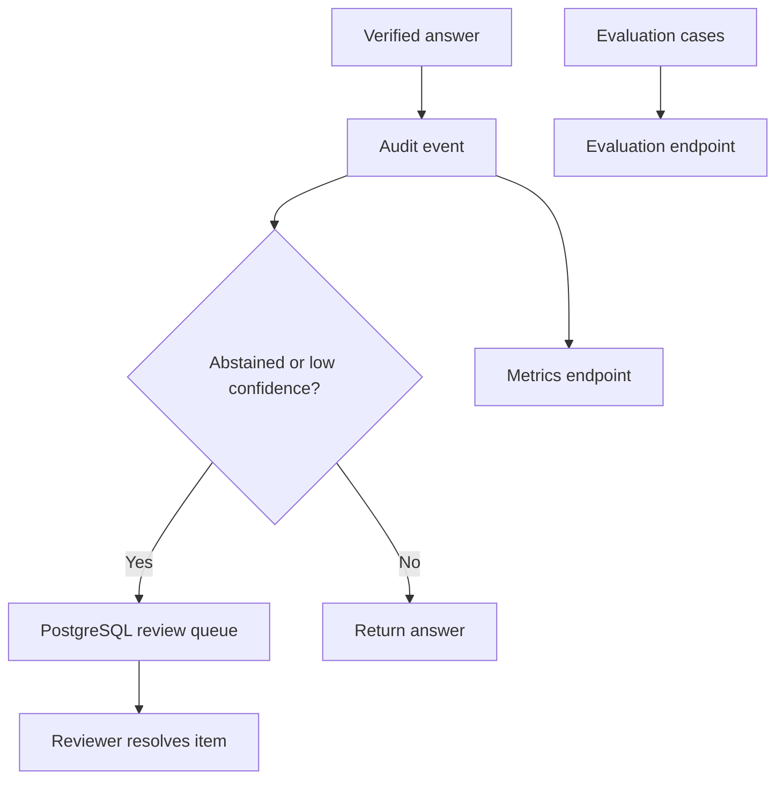

# Stage 7 — Evaluation, operations and human review

Stage 7 makes DecisionGraph measurable and reviewable. The RAG answer path from Stage 6 remains
unchanged: claims are still generated as structured output, verified against citations, and safely
abstained when evidence is insufficient.

## What Stage 7 adds



| Capability | What it does |
| --- | --- |
| Audit event | Records the tenant, requester, route, decision, latency, retrieved chunk IDs, and confidence scores in PostgreSQL. |
| Review queue | Creates a pending review item for an abstention or an answer below `REVIEW_CONFIDENCE_THRESHOLD`. |
| Reviewer resolution | Allows a pending item to be approved or rejected with reviewer ID and notes. |
| Metrics | Reports tenant-scoped answer volume, answered/abstained counts, average latency, confidence, and pending reviews. |
| Evaluation runner | Runs a bounded set of expected-answer/decision/source checks to make regressions measurable. |
| Optional API key | When `API_ACCESS_KEY` is configured, every `/v1/*` endpoint requires the `X-API-Key` header. |
| Rate limit adapter | Provides a process-local fixed-window limit. It is intentionally disabled by default for local development. |

## Human-in-the-loop lifecycle

1. A user asks a question through `POST /v1/answers`.
2. The system retrieves evidence, drafts claims, verifies them and calculates confidence.
3. PostgreSQL records an audit event.
4. If the answer abstains or confidence is below 0.80, the API also creates a pending review item.
5. A reviewer sees the question, confidence, proposed answer (when applicable), and citation audit
   trail. They approve or reject the item and add a reason.
6. Their decision can be added to the evaluation set later. This turns review feedback into a
   measurable quality-improvement loop.

The current API exposes the data and workflow foundation. A React reviewer dashboard and real
identity-provider role checks are intentionally still future work.

## Live verification

After rebuilding the container, repeat the Stage 6 marketing-budget question. Because it abstains,
the answer response should include a `review` object with `status: "pending"`.

List pending items:

```bash
curl -s 'http://localhost:8000/v1/reviews?tenant_id=acme&review_status=pending' \
  | python3 -m json.tool
```

Inspect operational metrics:

```bash
curl -s 'http://localhost:8000/v1/metrics?tenant_id=acme' | python3 -m json.tool
```

Run a small regression evaluation. This makes real model calls and therefore incurs the normal
embedding/generation cost:

```bash
curl -s -X POST http://localhost:8000/v1/evaluations/run \
  -H 'Content-Type: application/json' \
  -d '{
    "tenant_id":"acme",
    "user_id":"sujal",
    "allowed_scopes":["team"],
    "cases":[
      {
        "question":"Who owns payment reliability?",
        "expected_decision":"answered",
        "expected_terms":["Priya Shah"],
        "expected_source":"atlas_status.md"
      },
      {
        "question":"What marketing budget was approved for the Atlas launch?",
        "expected_decision":"abstained",
        "expected_terms":["enough verified evidence"]
      }
    ]
  }' | python3 -m json.tool
```

## Security boundary and limitations

These controls help, but they are not a substitute for a company authentication system:

- `tenant_id`, `user_id`, and `allowed_scopes` are currently request fields. In production, derive
  them from signed identity claims rather than trusting client input.
- `API_ACCESS_KEY` is one shared gateway-style key, not per-user authorization. Configure it in a
  secret manager and send it only over HTTPS.
- The included rate limiter is process-local. A multi-container deployment needs a Redis atomic
  limiter or API gateway rate limiting keyed by authenticated user/tenant.
- Reviewer endpoints record decisions but do not yet enforce a reviewer role. Put them behind an
  admin/reviewer authorization policy.
- Audit events contain user questions. Apply retention rules, encryption, redaction, and access
  controls before storing sensitive company data.
- `AUDIT_REQUIRED=false` favours availability: an answer still returns if its audit write fails.
  Set it to `true` where compliance requires every answer to be recorded.

## Configuration

| Setting | Default | Meaning |
| --- | --- | --- |
| `REVIEW_CONFIDENCE_THRESHOLD` | `0.80` | Create a review item below this confidence score. |
| `AUDIT_REQUIRED` | `false` | Return HTTP 503 instead of an answer if audit persistence fails. |
| `API_ACCESS_KEY` | empty | Enable shared-key protection for all `/v1/*` routes. |
| `RATE_LIMIT_REQUESTS_PER_MINUTE` | `0` | Process-local request limit per client address; `0` disables it. |

## What an interviewer should notice

This is not a chatbot-only RAG demo. It separates source-of-truth storage, graph enrichment,
retrieval, evidence fusion, verified generation, auditability, evaluation, and human review. It
also names the production gaps honestly instead of presenting local configuration as enterprise
authentication.
